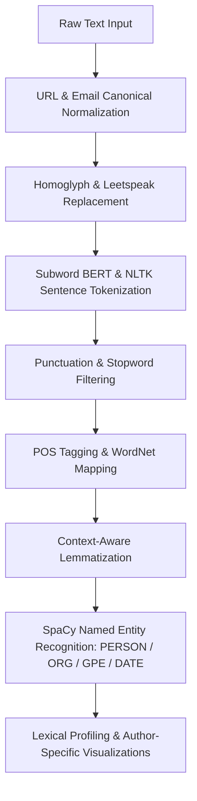

# NLP Preprocessing & Semantic Normalization Pipeline

[](https://www.python.org/)
[](https://huggingface.co/)
[](https://spacy.io/)
[](https://www.nltk.org/)
[](tests/test_nlp_pipeline.py)
[](LICENSE)

An end-to-end Natural Language Processing (NLP) text normalization, tokenization, and linguistic feature extraction pipeline evaluated on the **Spooky Author Identification** corpus (Edgar Allan Poe, Mary Shelley, and HP Lovecraft).

---

## Academic Context & Provenance

* **Institution:** École Nationale Supérieure d'Informatique de Sidi Bel Abbès (ESI-SBA)
* **Program:** 2ème Année Second Cycle (M2) — Option: Intelligence Artificielle et Science des Données (IASD)
* **Module:** Natural Language Processing (NLP)
* **Lab:** Fiche TP N° 01 — *Le Prétraitement en NLP*
* **Primary Deliverable:** `main.ipynb` & modular engine `nlp_pipeline.py`

---

## Pipeline Architecture



---

## Core Capabilities

1. **Entity Normalization:** Standardizes arbitrary hyperlinks (`<url>`) and email handles (`<email>`) to preserve structural semantics while reducing vocabulary explosion.
2. **Homoglyph & Leetspeak Defense:** Translates adversarial character substitutions (`$p00ky` $\rightarrow$ `spooky`) via unicode glyph mapping tables.
3. **Subword & Morphological Analysis:**
   - WordPiece subword tokenization leveraging HuggingFace's `bert-base-uncased` tokenizer.
   - Morphological reduction using NLTK `WordNetLemmatizer` paired with context-sensitive POS tags.
4. **Information Extraction & Lexical Profiling:**
   - SpaCy entity categorization across `PERSON`, `ORG`, `GPE`, and `DATE`.
   - Author-level lexical divergence visualizations (Waffle frequency plots and sentiment WordClouds).

---

## Project Structure

```plaintext
nlp-lab1/
├── nlp_pipeline.py            # Modular, tested text preprocessing engine
├── main.ipynb                 # Comprehensive research & exploratory analysis notebook
├── tests/
│   └── test_nlp_pipeline.py   # Automated unit test suite (5/5 passed)
├── lab.pdf                    # Official university assignment specification
├── spooky.csv                 # Benchmark corpus (authors: EAP, MWS, HPL)
├── .gitignore                 # Python & Jupyter cache exclusions
└── README.md                  # Technical & academic documentation
```

---

## Quickstart & Verification

### 1. Run Automated Test Suite
```bash
pytest tests/ -v
```
Expected output:
```plaintext
tests/test_nlp_pipeline.py::TestNLPPipeline::test_clean_and_tokenize_words PASSED
tests/test_nlp_pipeline.py::TestNLPPipeline::test_filter_lexicon PASSED
tests/test_nlp_pipeline.py::TestNLPPipeline::test_normalize_entities_email PASSED
tests/test_nlp_pipeline.py::TestNLPPipeline::test_normalize_entities_url PASSED
tests/test_nlp_pipeline.py::TestNLPPipeline::test_replace_homoglyphs PASSED
============================== 5 passed in 0.10s ==============================
```

### 2. Standalone Pipeline Execution
```python
from nlp_pipeline import clean_and_tokenize_words

raw = "Discover $p00ky mysteries at https://spooky.ai or email contact@lovecraft.org"
tokens = clean_and_tokenize_words(raw)
print(tokens)
# ['Discover', 'spooky', 'mysteries', 'at', '<url>', 'or', 'email', '<email>']
```
